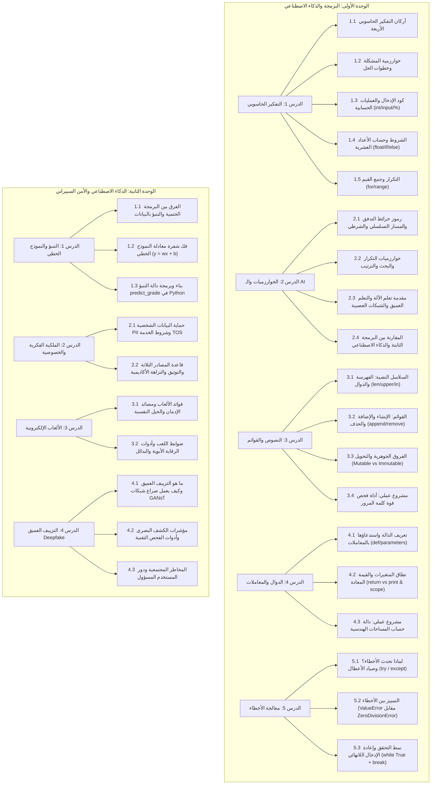

# خريطة منهج الحاسب وتكنولوجيا المعلومات - الصف الثالث الإعدادي (الفصل الدراسي الأول 2026 / 2027 م)
## Curriculum Map: Egyptian ICT Textbook (Preparatory 3 - Term 1)

---

## 1. بيانات الكتاب الأساسية (Book Metadata)

| البند | البيان |
| :--- | :--- |
| **عنوان الكتاب** | الكمبيوتر وتكنولوجيا المعلومات والاتصالات |
| **الصف الدراسي** | الصف الثالث الإعدادي (Preparatory 3) |
| **الفصل الدراسي** | الفصل الدراسي الأول (Term 1) |
| **العام الدراسي** | 2026 / 2027 م |
| **إجمالي عدد الصفحات** | 96 صفحة (الصفحة 96 بيضاء/فارغة) |
| **الإشراف العام** | د. جبريل أنور حميدة (رئيس الإدارة المركزية لتطوير المناهج) |
| **فرق الإعداد والمراجعة** | • **د. منال زيادة عبد الفضيل**: خبير مناهج ICT (الإدارة العامة لتخطيط وصياغة المناهج) • **أ. محمد عبد التواب**: معلم خبير بمدارس المتفوقين STEM • **د. محمد يوسف الصادق**: مدير إدارة بالكمبيوتر التعليمي (الإدارة العامة لمتابعة وتقييم المناهج) • **د. عبير حامد أحمد**: مستشارة الكمبيوتر التعليمي (الإدارة العامة لمتابعة وتقييم المناهج) • **د. طاهر عبد الحميد العدلي أحمد**: استشاري الإدارة العامة ورئيس قسم ICT (الإدارة العامة لتخطيط وصياغة المناهج) • **أ.د. الغريب زاهر إسماعيل**: أستاذ تكنولوجيا التعليم (جامعة المنصورة - كلية التربية) |
| **التصميم والإخراج الفني** | أ. حنان محمد علي (رئيس قسم التكنولوجيا) |
| **رابط المصدر الأصلي** | `docs/sources/ICT_ARABIC_Prp3_TR1.pdf` |

---

## 2. الهيكل العام للكتاب وتوزيع الوحدات والدروس (Full Structure)

يتكون المنهج الجديد كلياً من **وحدتين رئيسيتين** تضمان **9 دروس**، موزعة كما يلي:

| الوحدة / الدرس | عنوان الموضوع | نطاق الصفحات (PDF والكتاب) | طبيعة الدرس |
| :--- | :--- | :---: | :---: |
| **غلاف وفهرس** | بيانات الغلاف وفريق العمل وفهرس الموضوعات | 1 – 3 | تمهيد |
| **الوحدة الأولى** | **الذكاء الاصطناعي ولغات البرمجة** | **4 – 63** | **تأسيس حاسوبي وبرمجي** |
| الدرس 1 | التفكير الحاسوبي وحل المشكلات | 5 – 17 | نظري مفاهيمي + تطبيقي Python |
| الدرس 2 | خوارزميات الذكاء الاصطناعي | 18 – 30 | نظري ومفاهيمي + خرائط تدفق وأمثلة |
| الدرس 3 | السلاسل النصية Strings والقوائم Lists في لغة Python | 31 – 42 | برمجة Python عملية |
| الدرس 4 | الدوال ذات المعاملات في لغة Python | 43 – 52 | برمجة Python عملية |
| الدرس 5 | معالجة أخطاء مدخلات المستخدم في لغة Python | 53 – 63 | برمجة Python عملية |
| **الوحدة الثانية** | **الذكاء الاصطناعي والأمن السيبراني** | **64 – 95** | **تطبيقات ذكاء اصطناعي ووعي سيبراني** |
| الدرس 1 | التنبؤ باستخدام نموذج الذكاء الاصطناعي | 65 – 75 | نمذجة رياضية + برمجة Python |
| الدرس 2 | الذكاء الاصطناعي وحقوق الملكية الفكرية | 76 – 80 | نظري / أخلاقيات وقيم رقمية |
| الدرس 3 | الوعي السيبراني والألعاب الإلكترونية الخطرة | 81 – 86 | نظري / أمن سيبراني وصحة رقمية |
| الدرس 4 | الذكاء الاصطناعي والتزييف العميق (Deepfake) | 87 – 95 | نظري ومفاهيمي / كشف التزييف والأمان |
| **نهاية الكتاب** | صفحة بيضاء | 96 | ختام |

> [!NOTE]
> أرقام الصفحات المطبوعة في تذييل الكتاب تطابق تماماً أرقام صفحات ملف الـ PDF (الصفحة 5 في الـ PDF هي الصفحة 5 في الكتاب).
> هناك خطأ مطبعي طفيف في ترويسة صفحات الوحدة الثانية؛ حيث استمرت الترويسة العليا لكامل دروس الوحدة الثانية في طباعة عنوان "الوحدة الأولى: الذكاء الاصطناعي ولغات البرمجة" بدلاً من الوحدة الثانية، رغم أن صفحة غلاف الوحدة (ص 64) والفهرس (ص 3) يثبتان اسم "الوحدة الثانية: الذكاء الاصطناعي والأمن السيبراني".

---

## 3. تفاصيل محتوى الدروس (Detailed Lesson Maps)

---

### الوحدة الأولى: الذكاء الاصطناعي ولغات البرمجة (ص 4 – 63)

#### الدرس الأول: التفكير الحاسوبي وحل المشكلات
* **نطاق الصفحات:** 5 – 17 (13 صفحة)
* **الأهداف التعليمية المعلنة:**
  1. يشرح معنى التفكير الحاسوبي.
  2. يحدد خطوات حل المشكلة.
  3. يكتب خوارزمية بسيطة.
* **المفاهيم والمصطلحات الأساسية:**
  * التفكير الحاسوبي (Computational Thinking)
  * أركان التفكير الحاسوبي الأربعة:
    1. تحليل / تفكيك المشكلة (Decomposition)
    2. التعرف على الأنماط (Pattern Recognition)
    3. التجريد (Abstraction)
    4. تصميم الخوارزمية (Algorithm Design)
  * خطوات حل المشكلة (Problem Solving Steps): فهم المشكلة، تحديد المدخلات والمخرجات، وضع خطوات الحل، تحويل الحل إلى كود، اختبار الحل.
  * باقي القسمة (Modulo / Remainder)، الأعداد الصحيحة (Integers)، الأعداد العشرية (Floating-point numbers)، المقارنة والشروط (Conditionals)، الحلقات التكرارية (Loops).
* **التراكيب البرمجية في Python المستخدمة:**
  * الدوال المدمجة: `input()`, `int()`, `float()`, `print()`, `range()`
  * المعاملات الحسابية والمنطقية: `+`, `-`, `*`, `/`, `%`, `==`, `>`, `+=`
  * الجمل الشرطية: `if`, `else`
  * الحلقات التكرارية: `for ... in range(...)`
  * معالجة الأخطاء السريعة: التنبيه النظري لخطأ `ValueError` عند إدخال نصوص في دالة `int()`
* **الأمثلة المحلولة (Worked Examples):** إجمالي 6 أمثلة محلولة:
  1. *مثال تمهيدي (ص 7):* جمع رقمين (تحليل المشكلة، الأنماط، التجريد، الخوارزمية، الكود، وتنبيه الخطأ).
  2. *مثال 1 (ص 8):* تحديد هل الرقم زوجي أم فردي (`num % 2 == 0`).
  3. *مثال 2 (ص 9):* حساب متوسط 3 أرقام وتبرير استخدام `float()` للحفاظ على الدقة.
  4. *مثال 3 (ص 10):* حساب مساحة المستطيل (`length * width`).
  5. *مثال 4 (ص 10 – 11):* تحديد أكبر رقم من بين رقمين (`if a > b`).
  6. *مثال 5 (ص 11 – 12):* حساب مجموع الأعداد من 1 إلى 5 باستخدام حلقة `for` و `range(1, 6)`.
* **الأنشطة (Activities):**
  * نشاط تطبيقي فردي (ص 12): طالب حصل على 3 درجات، احسب هل هو ناجح أم لا (المطلوب: كتابة خطوات التفكير الحاسوبي ثم كتابة الكود).
* **الأسئلة والتدريبات الختامية:** إجمالي 40 سؤالاً:
  * أسئلة صواب أو خطأ: 20 سؤالاً (ص 13).
  * أسئلة اختيار من متعدد (MCQ): 20 سؤالاً (ص 14 – 17).

---

#### الدرس الثاني: خوارزميات الذكاء الاصطناعي
* **نطاق الصفحات:** 18 – 30 (13 صفحة)
* **الأهداف التعليمية المعلنة:**
  1. يشرح أنواع الخوارزميات.
  2. يميز بين الخوارزميات التقليدية وخوارزميات الذكاء الاصطناعي.
  3. يكتب خوارزميات بسيطة بلغة Python.
* **المفاهيم والمصطلحات الأساسية:**
  * الخوارزمية (Algorithm)
  * خرائط التدفق (Flowcharts) ورموزها القياسية: الشكل البيضاوي (البداية/النهاية Terminal)، المستطيل (العمليات Process)، متوازي الأضلاع (الإدخال/الإخراج I/O)، المعين (القرار/الشرط Decision).
  * أنواع الخوارزميات التقليدية:
    1. خوارزميات تسلسلية (Sequential Algorithms)
    2. خوارزميات شرطية (Conditional Algorithms)
    3. خوارزميات تكرارية (Loop Algorithms)
    4. خوارزميات البحث (Search Algorithms)
    5. خوارزميات الترتيب (Sorting Algorithms)
  * خوارزميات الذكاء الاصطناعي (AI Algorithms):
    * تعلم الآلة (Machine Learning - ML): التعلم من الأمثلة والبيانات دون برمجة كل خطوة صراحة (مثال: تصنيف البريد العادي والمزعج Spam).
    * التعلم العميق (Deep Learning - DL): محاكاة العقل البشري بالاعتماد على الشبكات العصبية (Neural Networks) لتمييز الصور والأصوات.
  * جدول المقارنة الجوهري بين الخوارزميات التقليدية (خطوات ثابتة ومبرمجة بالكامل ولا تتغير) وخوارزميات الذكاء الاصطناعي (تتعلم من البيانات وتتحسن وتتدرب بمرور الوقت).
* **التراكيب البرمجية في Python المستخدمة:**
  * جمل الإدخال والطباعة: `input()`, `print()`
  * الشروط: `if`, `else`, معامل المقارنة `>=`
  * التكرار والعدادات: حلقة تكرار لطباعة نص عدد معين من المرات
  * الدوال المرتبطة بالقوائم المذكورة مفاهيمياً: `sort()`, خوارزميات البحث الخطي البسيط
  * برنامج التنبؤ الشرطي البسيط (ص 26): كود فحص درجة الطالب (`if score >= 50:`).
* **الأمثلة المحلولة وخرائط التدفق:** 6 حالات توضيحية بخرائط تدفق وكود:
  1. طباعة رسالة ترحيب متبوعة باسم المستخدم (تسلسلية).
  2. تحديد هل الرقم موجب أم سالب (شرطية).
  3. طباعة كلمة Hello خمس مرات باستخدام عداد وشرط تكراري (تكرارية).
  4. البحث عن الرقم 10 في قائمة وعرض "Found" إن وُجد (بحث).
  5. ترتيب قائمة أرقام تصاعدياً (ترتيب).
  6. فحص وتوقع نجاح الطالب بناءً على درجته (تنبؤ تقليدي مقابل تعلم آلي).
* **الأنشطة (Activities):**
  * تحدي تطويري للطالب (ص 26): تطوير برنامج التنبؤ ليعطي تقديرات متعددة: ممتاز – جيد – ضعيف.
* **الأسئلة والتدريبات الختامية:** إجمالي 39 سؤالاً:
  * أسئلة صواب أو خطأ: 19 سؤالاً (ص 27).
  * أسئلة اختيار من متعدد (MCQ): 20 سؤالاً مقسمة لمفاهيم الخوارزميات، الذكاء الاصطناعي، وتحليل الأكواد (ص 28 – 30).

---

#### الدرس الثالث: السلاسل النصية Strings والقوائم Lists في لغة Python
* **نطاق الصفحات:** 31 – 42 (12 صفحة)
* **الأهداف التعليمية المعلنة:**
  1. يفهم معنى السلاسل النصية والقوائم.
  2. يفرق بين التعامل مع النصوص والحروف.
  3. يكتب برنامجاً بسيطاً باستخدام الحلقات التكرارية مع النصوص والقوائم.
* **المفاهيم والمصطلحات الأساسية:**
  * السلاسل النصية (Strings): نصوص محاطة باقتباس مزدوج `" "` أو مفرد `' '`.
  * الفهرسة الموجبة والسالبة (Zero-based positive Indexing & Negative Indexing).
  * دالة الطول (`len`).
  * البحث داخل السلسلة باستخدام معامل التضمين (`in`).
  * تحويل حالة الحروف إلى حروف كبيرة (`upper()`).
  * القوائم (Lists): مصفوفات/قوائم مرتبة وقابلة للتعديل محاطة بأقواس مربعة `[ ]`.
  * العمليات على القوائم: الوصول للعناصر بالفهرس، الإضافة (`append`)، الحذف (`remove`)، التكرار على القوائم.
  * جدول المقارنة بين String و List: نوع البيانات، القابلية للتعديل (Mutable مقابل Immutable)، الأقواس المحيطة، وتعديل العناصر.
  * تحويل النصوص إلى قوائم (`list(text)`).
  * التحكم في الحلقات باستخدام كلمة كسر الحلقة (`break`).
* **التراكيب البرمجية في Python المستخدمة:**
  * الفهرسة والتقطيع: `text[0]`, `text[-1]`
  * الدوال والتوابع (Methods): `len()`, `list()`, `text.upper()`, `list.append()`, `list.remove()`
  * المعاملات: `in`, `==`, `+=`, `>=`
  * الحلقات وجمل التحكم: `for letter in text:`, `for item in list:`, `break`
  * الشروط: `if`
* **الأمثلة المحلولة (Worked Examples):**
  1. *عمليات النصوص (ص 32 – 33):* فحص الطول، طباعة الحرف الأول والأخير، التكرار بالحروف، البحث بـ `in`، وتكبير الحروف بـ `upper()`.
  2. *عمليات القوائم (ص 34):* الوصول للعنصر الأول، إضافة عنصر بـ `append`، حذف عنصر بـ `remove`، والتكرار على عناصر القائمة.
  3. *التحويل بين النصوص والقوائم (ص 35):* تجزئة الكلمة لقائمة حروف `letters = list(text)`.
  4. *تطبيق عملي 1 (ص 35 – 36):* برنامج فحص قوة كلمة المرور (Password Strength Checker): التحقق من طول الكلمة (`len >= 6`) والبحث عن وجود رموز خاصة (`@#$%&`) باستخدام حلقة و `break` لحساب درجة الأمان (`score`).
  5. *تطبيق عملي 2 (ص 36 – 37):* فلترة وطباعة الأسماء التي تبدأ بحرف `"A"` من قائمة أسماء (`names = [...]`, `if name[0] == "A"`).
* **الأنشطة (Activities):**
  * تطبيق عملي مدمج في الدرس لفحص قوة كلمة المرور وتجربة كلمات مختلفة.
* **الأسئلة والتدريبات الختامية:** إجمالي 39 سؤالاً:
  * أسئلة صواب أو خطأ: 20 سؤالاً (ص 37).
  * أسئلة اختيار من متعدد (MCQ): 19 سؤالاً (ص 38 – 42: السؤال 19 يتضمن كود فحص كلمة المرور على صفحتين).

---

#### الدرس الرابع: الدوال ذات المعاملات في لغة Python
* **نطاق الصفحات:** 43 – 52 (10 صفحات)
* **الأهداف التعليمية المعلنة:**
  1. يشرح معنى الدالة (Function).
  2. ينشئ دالة تحتوي على معاملات (Parameters).
  3. يستخدم الدوال في حل مشكلات رياضية وبرمجية.
* **المفاهيم والمصطلحات الأساسية:**
  * الدالة (Function): مجموعة من التعليمات البرمجية تُكتب مرة واحدة وتُستدعى عدة مرات لتجنب التكرار وتسهيل الصيانة.
  * المعاملات (Parameters): المتغيرات المعرفة بين قوسي الدالة لتمثل المدخلات التي تحتاجها الدالة لتعمل.
  * الوسائط / المعطيات (Arguments): القيم الفعلية التي تُمرر للدالة عند استدعائها.
  * القيمة المعادة (Return Value): استخدام `return` لإرجاع ناتج يمكن تخزينه في متغير واستخدامه في عمليات أخرى.
  * الفرق بين العرض (`print`) والإرجاع (`return`).
  * نطاق المتغيرات المحلي (Local Scope): المتغيرات المعرفة داخل الدالة لا يمكن الوصول إليها من خارجها (حدوث `NameError` عند محاولة طباعتها خارج الدالة).
* **التراكيب البرمجية في Python المستخدمة:**
  * الكلمات المفتاحية: `def`, `return`
  * بناء الجملة (Syntax): `def function_name(parameters):`
  * استدعاء الدوال وتمرير القيم: `add_numbers(3, 5)`, `circle_area(10)`
  * العمليات الحسابية والصيغ الهندسية: حساب مساحة الدائرة ($\pi \times r^2$).
  * استخدام الشروط داخل الدوال: `if ... return ... else: return ...`
* **الأمثلة المحلولة (Worked Examples):**
  1. *مثال تمهيدي (ص 45):* دالة جمع رقمين `add_numbers(a, b)` وطباعة الناتج.
  2. *تطبيق هندسي عملي (ص 45 – 46):* دالة حساب مساحة الدائرة `circle_area(radius)` باستخدام قيمة تقريبية $\pi = 3.14$ وطباعة الناتج لشعاع $r=5$ و $r=10$.
  3. *تدريب تطبيقي محلول (ص 46 – 47):* تعديل دالة مساحة الدائرة لاستبدال دالة الطباعة بالكلمة المفتاحية `return area` وتخزين الناتج في متغير خارجي `result`.
* **الأنشطة (Activities):**
  * تدريب تطبيقي (ص 46 – 47): إعادة كتابة الدالة لتستخدم `return` بدلاً من `print` وتتبع التنفيذ خطوة بخطوة.
* **الأسئلة والتدريبات الختامية:** إجمالي 40 سؤالاً:
  * أسئلة صواب أو خطأ: 20 سؤالاً (ص 47 – 48).
  * أسئلة اختيار من متعدد (MCQ): 20 سؤالاً (ص 48 – 52).

---

#### الدرس الخامس: معالجة أخطاء مدخلات المستخدم في لغة Python
* **نطاق الصفحات:** 53 – 63 (11 صفحة)
* **الأهداف التعليمية المعلنة:**
  1. يشرح سبب حدوث الأخطاء عند إدخال البيانات.
  2. يستخدم `try` و `except` لمعالجة الأخطاء.
  3. يكتب برامج بسيطة لا تتوقف عند حدوث خطأ.
* **المفاهيم والمصطلحات الأساسية:**
  * أخطاء وقت التشغيل الناتجة عن مدخلات المستخدم (Runtime Input Errors & Crashes).
  * صيد الاستثناءات ومعالجتها (Exception Handling).
  * كتلتي المحاولة والاعتراض (`try` و `except`).
  * أنواع الاستثناءات المحددة:
    * `ValueError`: يحدث عند فشل تحويل نص غير رقمي إلى عدد بواسطة `int()`.
    * `ZeroDivisionError`: يحدث عند محاولة القسمة على الصفر.
  * معالجة استثناءات متعددة في نفس البرنامج برسائل خطأ مخصصة لكل نوع.
  * حلقة التحقق وإعادة المحاولة حتى إدخال قيمة صحيحة (Validation & Retry loop).
  * تضمين معالجة الأخطاء داخل الدوال لجعل الكود احترافياً ومقاوماً للانهيار.
* **التراكيب البرمجية في Python المستخدمة:**
  * الكلمات المفتاحية: `try`, `except`, `except ValueError:`, `except ZeroDivisionError:`
  * حلقات الإعادة والكسر: `while True:`, `break`
  * الإدخال والتحويل: `input()`, `int()`, القسمة الحسابية `/`
* **الأمثلة المحلولة (Worked Examples):**
  1. *مثال توضيحي للمشكلة (ص 54 – 55):* قراءة العمر بدون حماية وما يحدث عند إدخال كلمة نصية.
  2. *مثال 1 (ص 55):* حماية إدخال العمر باستخدام `try` و `except` العامة لمنع انهيار البرنامج.
  3. *مثال 2 (ص 55 – 56):* التحقق من عمليتي إدخال وقسمة رقمين لمعالجة إدخال النصوص والقسمة على صفر في كتلة استثناء واحدة.
  4. *مثال 3 (ص 56):* تخصيص رسائل الخطأ بفصل `except ValueError` عن `except ZeroDivisionError`.
  5. *مثال 4 (ص 56 – 57):* نمط إعادة المحاولة اللانهائي باستخدام `while True` و `try / except` و `break` عند سلامة المدخل.
* **الأنشطة (Activities):**
  * توجيه للطالب (ص 57) لتطبيق مفهوم `try / except` على الدوال التي تمت برمجتها في الدرس السابق (مثل دوال الجمع وحساب المساحات).
* **الأسئلة والتدريبات الختامية:** إجمالي 40 سؤالاً:
  * أسئلة صواب أو خطأ: 20 سؤالاً (ص 57 – 58).
  * أسئلة اختيار من متعدد (MCQ): 20 سؤالاً (ص 58 – 63).

---

### الوحدة الثانية: الذكاء الاصطناعي والأمن السيبراني (ص 64 – 95)

#### الدرس الأول: التنبؤ باستخدام نموذج الذكاء الاصطناعي
* **نطاق الصفحات:** 65 – 75 (11 صفحة)
* **الأهداف التعليمية المعلنة:**
  1. يميز بين البرمجة التقليدية والتعلم الآلي.
  2. يناقش مفهوم التنبؤ (Pattern / Prediction) باستخدام البيانات.
  3. يفسر نموذجاً خطياً بسيطاً بلغة Python.
* **المفاهيم والمصطلحات الأساسية:**
  * البرمجة التقليدية القائمة على القواعد (Rule-Based Programming): قواعد ثابتة ومحددة سلفاً، نتائج حتمية لا تتغير، لا تتعلم من البيانات (مثل الآلة الحاسبة).
  * نموذج الذكاء الاصطناعي / التعلم الآلي (AI Model / Machine Learning): تحليل البيانات السابقة والتاريخية لاكتشاف الأنماط المخفية وبناء قواعد ذاتية للتنبؤ بالمستقبل.
  * التنبؤ (Prediction): توقع قيمة مجهولة مستقبلاً بالاعتماد على بيانات سابقة ووجود نمط متكرر.
  * النمط (Pattern): العلاقة الرياضية المتكررة بين متغيرين (مثل: كلما زادت ساعات المذاكرة زادت الدرجة).
  * النموذج الخطي (Linear Model): أبسط النماذج الرياضية في الذكاء الاصطناعي:
    $$y = w \cdot x + b$$
    * $x$: المدخل (Input) – عدد ساعات المذاكرة.
    * $y$: الناتج أو القيمة المتوقعة (Output / Prediction) – الدرجة التقديرية.
    * $w$: الوزن أو التأثير (Weight) – مقدار التغير في الدرجة لكل ساعة مذاكرة إضافية.
    * $b$: الانحياز أو القيمة الثابتة (Bias) – الدرجة المبدئية التي يبدأ منها الطالب قبل المذاكرة ($x=0$).
* **التراكيب البرمجية في Python المستخدمة:**
  * الدوال: `def predict_grade(x):`, `return y`
  * العمليات الحسابية: `w * x + b`
  * المتغيرات والطباعة: إسناد المتغيرات واستدعاء الدالة وطباعة الناتج.
* **الأمثلة المحلولة (Worked Examples):**
  1. *مثال جدولي تحليلي (ص 67 – 69):* جدول يوضح العلاقة بين ساعات المذاكرة (1، 2، 3) والدرجات (50، 60، 70) واستنتاج قيمة الزيادة الثابتة ($w=10$) والانحياز ($b=40$).
  2. *تطبيق Python للنموذج الخطي (ص 69 – 70):* كتابة دالة `predict_grade(x)` بمعاملات $w=5$ و $b=10$ وحساب الدرجة المتوقعة لطالب ذاكر 3 ساعات ($5 \times 3 + 10 = 25$).
* **الأنشطة (Activities):**
  * تدريب تحليلي صفي مدمج في الدرس لحساب النتيجة المتوقعة عند تغيير قيم الساعات، أو عند عدم المذاكرة نهائياً ($x=0$).
* **الأسئلة والتدريبات الختامية:** إجمالي 40 سؤالاً:
  * أسئلة صواب أو خطأ: 20 سؤالاً (ص 71).
  * أسئلة اختيار من متعدد (MCQ): 20 سؤالاً (ص 71 – 75).

---

#### الدرس الثاني: الذكاء الاصطناعي وحقوق الملكية الفكرية
* **نطاق الصفحات:** 76 – 80 (5 صفحات)
* **الأهداف التعليمية المعلنة:**
  1. يناقش حماية الملكية الفكرية عند استخدام تطبيقات الذكاء الاصطناعي.
  2. يشرح كيفية حماية بياناته الشخصية عند استخدام تطبيقات الذكاء الاصطناعي.
  3. يتعرف الملكية الفكرية وشروط الاستخدام (Terms of Service - TOS) في تطبيقات الذكاء الاصطناعي.
* **المفاهيم والمصطلحات الأساسية:**
  * معلومات التعريف الشخصية (Personally Identifiable Information - PII): الاسم الكامل، العنوان، رقم الهاتف، اسم المدرسة، أسرار الأسرة، الصور ومقاطع الفيديو العائلية، كلمات المرور.
  * شروط الاستخدام (Terms of Service - TOS) في تطبيقات مثل ChatGPT و Gemini:
    * الاشتراط العمري (Age Requirement - عادة 13 سنة فأكثر).
    * ملكية المحتوى الرقمي المولد ومن يمتلك الحقوق.
    * حق الحذف والخصوصية (Clear Data / Privacy Settings وحذف سجل المحادثات من الخوادم).
  * قاعدة المصادر الثلاثة (The Three Sources Rule) للتحقق من صحة وموثوقية المعلومات:
    1. *المصدر الأول:* الذكاء الاصطناعي (أفكار أولية ومساعدة عصف ذهني).
    2. *المصدر الثاني:* محرك بحث وموسوعات موثوقة (مثل ويكيبيديا وبنك المعرفة المصري).
    3. *المصدر الثالث:* كتب ومراجع متخصصة أو استشارة معلم/خبير.
  * النزاهة الأكاديمية والشفافية: توثيق استخدام أدوات الذكاء الاصطناعي في الهامش وقائمة المراجع لتجنب الانتحال والسرقة الأدبية (Plagiarism).
* **التراكيب البرمجية في Python المستخدمة:**
  * لا توجد (درس نظري توعوي يركز على المواطنة الرقمية والأخلاقيات وحماية الخصوصية).
* **الأمثلة المحلولة والسيناريوهات:**
  * سيناريوهات واقعية للبيانات التي يجب حجبها عن أدوات الذكاء الاصطناعي.
  * صيغة توثيق نموذجية: كتابة «تم استخدام ChatGPT في الحصول على هذه المعلومات» في هوامش الأبحاث.
* **الأنشطة (Activities):**
  * مناقشة صفية وتطبيق لقاعدة المصادر الثلاثة للتأكد من معلومة علمية.
* **الأسئلة والتدريبات الختامية:** إجمالي 10 أسئلة:
  * أسئلة اختيار من متعدد (MCQ): 10 أسئلة (ص 79 – 80).

---

#### الدرس الثالث: الوعي السيبراني والألعاب الإلكترونية الخطرة
* **نطاق الصفحات:** 81 – 86 (6 صفحات)
* **الأهداف التعليمية المعلنة:**
  1. يميز بين أنواع الألعاب الإلكترونية المختلفة ويحدد فوائدها ومخاطرها.
  2. يشرح إجراءات الحد من التأثير السلبي للألعاب الإلكترونية على المستوى العالمي.
  3. يقترح حلولاً عملية لإدارة وقت اللعب وتشجيع الأنشطة البديلة لتعزيز الصحة النفسية والاجتماعية.
* **المفاهيم والمصطلحات الأساسية:**
  * الألعاب الإلكترونية (Electronic Games / Video Games): برامج وتطبيقات تفاعلية للترفيه والتعليم تعمل على الحواسيب، الهواتف الذكية، ومنصات الألعاب (PlayStation, Xbox, Nintendo).
  * تصنيفات الألعاب: تعليمية، استراتيجية، جماعية، محاكاة، ترفيهية.
  * فوائد الألعاب: تحفيز التفكير، التخطيط وحل المشكلات، سرعة رد الفعل، تنشيط خلايا المخ، التعاون والعمل الجماعي.
  * المخاطر السيبرانية والنفسية والحيل التسويقية في الألعاب:
    * الأنماط المظلمة / الحيل النفسية الخفية (Dark Patterns) للإبقاء على اللاعب مدمنًا.
    * الدفع للفوز (Pay to Win).
    * صناديق الغنائم (Loot Boxes) ووصفها بالقمار القانوني.
    * الخوف من فوات الفرصة (FOMO - Fear Of Missing Out).
    * العنف، الألفاظ النابية، العزلة الاجتماعية، الألعاب الخطرة (أمثلة في الكتاب: Fortnite, PUBG, Carbone).
  * ضوابط الحماية وإدارة الوقت:
    * التوصيات الدولية للأطفال تحت 18 سنة (تحديد ساعات اللعب بحد أقصى ساعة يومياً أو 3 ساعات أسبوعياً).
    * دور الأسرة وأدوات الرقابة الأبوية (Parental Controls): تطبيق `Google Family Link` و `Apple Screen Time`.
    * البدائل الإيجابية (الرياضة، القراءة، الرسم، الابتكار).
* **التراكيب البرمجية في Python المستخدمة:**
  * لا توجد (درس أمن سيبراني وصحة رقمية).
* **الأمثلة المحلولة والسيناريوهات:**
  * تحليل نماذج من ألعاب شهيرة وآليات سحب الأموال والوقت عبر صناديق الغنائم ومواسم اللعب.
* **الأنشطة (Activities):**
  * نشاط عملي باستخدام أدوات الرقابة (ص 85): "ابحث عن أدوات مثل Google Family Link أو Apple Screen Time واشرح كيف يمكن استخدامها لتحديد وقت اللعب ومراقبة المحتوى."
* **الأسئلة والتدريبات الختامية:** إجمالي 10 أسئلة:
  * أسئلة اختيار من متعدد (MCQ): 10 أسئلة (ص 85 – 86).

---

#### الدرس الرابع: الذكاء الاصطناعي والتزييف العميق (Deepfake)
* **نطاق الصفحات:** 87 – 95 (9 صفحات)
* **الأهداف التعليمية المعلنة:**
  1. يشرح مفهوم الذكاء الاصطناعي والتزييف العميق.
  2. يتعرف على تقنيات Deepfake و GANs.
  3. يستخدم بعض الأدوات والتطبيقات لكشف المحتوى المزيف.
* **المفاهيم والمصطلحات الأساسية:**
  * التزييف العميق (Deepfake): استخدام الذكاء الاصطناعي لإنشاء صور أو فيديوهات أو أصوات مزيفة تبدو حقيقية جداً.
  * الشبكات التوليدية التنافسية (GANs - Generative Adversarial Networks):
    * المولد (Generator): ينشئ البيانات والصور المزيفة ويحسنها لتبدو حقيقية.
    * المميز (Discriminator): يفحص البيانات ويكتشف هل هي حقيقية أم مزيفة.
    * حلقة التنافس: آلاف المحاولات التنافسية بين المولد والمميز في أجزاء من الثانية حتى يصل التزييف لأقصى درجات الواقعية (تشبيه المزوّر والمحقق).
  * مؤشرات وعلامات كشف التزييف بالعين المجردة:
    1. حركة العين ورمش الأجفان غير الطبيعي (قلة الرمش أو بطؤه الشديد).
    2. عدم اتساق إضاءة وظلال الوجه مع الخلفية أو الغرفة.
    3. عدم تطابق الصوت مع حركة الشفاه (Lip-syncing errors).
    4. تشوهات حواف الوجه والضبابية أثناء الالتفات والحركة السريعة.
  * أدوات وتقنيات الكشف الآلي (AI-based Detection Tools):
    * `Deepware Scanner`
    * `Sensity AI`
    * `Microsoft Video Authenticator`
  * مخاطر التزييف العميق: التضليل والأخبار الكاذبة، التشهير والابتزاز، الاحتيال الإلكتروني وانتحال الشخصيات.
  * قواعد الحماية والمواطنة الرقمية الواعية: عدم التصديق الأعمى، التثبت من المصادر الرسمية، التفكير الناقد، والامتناع عن مشاركة أي محتوى مريب.
* **التراكيب البرمجية في Python المستخدمة:**
  * لا توجد أكواد برمجية (مفاهيم تقنية متقدمة في التعلم العميق والأمن الرقمي).
* **الأمثلة المحلولة والسيناريوهات:**
  * تشبيه صانع التزييف والمحقق (GANs).
  * نماذج من فيديوهات الرؤساء والمشاهير المزيفة.
* **الأنشطة والتدريبات:**
  * تدريب (ص 90): "ماذا ستفعل إذا شاهدت فيديو مشكوكاً في صحته؟"
  * نشاط تطبيقي (ص 90): "قم بالبحث عن فيديو على الإنترنت، ثم حاول تحليل: هل هو حقيقي أم مزيف؟ وما الأدلة التي اعتمدت عليها؟"
* **الأسئلة والتدريبات الختامية:** إجمالي 37 سؤالاً:
  * أسئلة صواب أو خطأ: 18 سؤالاً (ص 91).
  * أسئلة اختيار من متعدد (MCQ): 19 سؤالاً (ص 92 – 95).

---

## 4. موقف لغة Visual Basic .NET في المنهج (VB.NET Status)

* **هل يوجد أي محتوى للغة Visual Basic .NET في الكتاب؟**
  * **الإجابة القاطعة: لا (NO)**، لا يوجد أي ذكر أو كود أو إشارة من قريب أو بعيد للغة Visual Basic أو بيئة Visual Studio في أي صفحة من صفحات الكتاب البالغة 96 صفحة.
* **ملاحظة تاريخية وتحليلية للمنهج:**
  * اعتمدت وزارة التربية والتعليم المصرية لأكثر من 15 عاماً على لغة Visual Basic .NET لطلاب الصف الثالث الإعدادي (حل المشكلات، خرائط التدفق، نافذة الخصائص ومفهوم الكائنية OOP والأدوات البرمجية).
  * بدءاً من العام الدراسي **2026 / 2027 م**، تم إلغاء لغة Visual Basic بالكامل واستبدالها بمنهج عصري شامل يعتمد على **لغة Python**، و**الذكاء الاصطناعي (AI & Machine Learning)**، و**الأمن السيبراني (Cybersecurity)**، و**التفكير الحاسوبي (Computational Thinking)**.

---

## 5. الموضوعات غير البرمجية ومواضع ظهورها (Non-Programming Topics)

يحتوي الكتاب على مزيج متوازن بين المهارات البرمجية والوعي النظري والتقني الحديث. وتتوزع الموضوعات غير البرمجية (Non-Programming Topics) عبر الوحدتين كما يلي:

| الموضوع غير البرمجي | تصنيف الموضوع | موضع الظهور (الوحدة والدرس والصفحات) | أهم المحاور التي يغطيها |
| :--- | :--- | :--- | :--- |
| **التفكير الحاسوبي النظري** | Computational Thinking | الوحدة 1 - الدرس 1 (ص 5 – 7) | الأركان الأربعة: التفكيك، التعرف على الأنماط، التجريد، تصميم الخوارزميات، والفرق بين التفكير البشري والآلي. |
| **خرائط التدفق وتصنيف الخوارزميات** | Algorithmic Thinking | الوحدة 1 - الدرس 2 (ص 18 – 24) | المعايير الهندسية لخرائط التدفق (الرموز القياسية)، تسلسل العمليات، التفرع والتكرار بيانياً. |
| **مفاهيم تعلم الآلة والتعلم العميق** | Machine Learning & Deep Learning Concepts | الوحدة 1 - الدرس 2 (ص 24 – 26) | الفارق الجوهري بين البرمجة الحتمية والتعلم الذاتي، دور الشبكات العصبية، تمييز الصور والبريد المزعج. |
| **مفاهيم النمذجة والتنبؤ الرياضي** | Data Science & Prediction Models | الوحدة 2 - الدرس 1 (ص 65 – 69) | البيانات التاريخية، اكتشاف الأنماط، التنبؤ المستقبلي، معادلة النموذج الخطي ($y = wx + b$) وتفسير الوزن والانحياز. |
| **الملكية الفكرية وحماية الخصوصية** | Digital Rights & Privacy | الوحدة 2 - الدرس 2 (ص 76 – 78) | حماية معلومات الهوية الشخصية (PII)، شروط استخدام أدوات الذكاء الاصطناعي (TOS)، حق حذف البيانات من السيرفرات. |
| **النزاهة الأكاديمية وقاعدة المصادر الثلاثة** | Academic Integrity & Fact Checking | الوحدة 2 - الدرس 2 (ص 78) | التوثيق العلمي عند الاستعانة بالذكاء الاصطناعي، تجنب الانتحال والسرقة الأدبية، والتحقق عبر ثلاثة مصادر مستقلة. |
| **تصنيفات الألعاب والتأثيرات السلوكية** | Digital Wellbeing & Game Mechanics | الوحدة 2 - الدرس 3 (ص 81 – 83) | أنواع الألعاب وفوائدها الذهنية والعصبية، مقابل مخاطر الألعاب العنيفة والإدمان والعزلة الاجتماعية. |
| **الحيل النفسية والتسويقية في الألعاب** | Cyber Psychology & Dark Patterns | الوحدة 2 - الدرس 3 (ص 83 – 84) | الأنماط المظلمة (Dark Patterns)، الدفع للفوز (Pay-to-Win)، صناديق الغنائم (Loot Boxes)، وقلق فوات الفرص (FOMO). |
| **إدارة الوقت وأدوات الرقابة الأبوية** | Screen Time & Parental Controls | الوحدة 2 - الدرس 3 (ص 84 – 85) | الضوابط الزمنية لمن دون 18 سنة، أدوات Google Family Link و Apple Screen Time، ودور الأهل والأنشطة البديلة. |
| **تكنولوجيا التزييف العميق وشبكات GANs** | Generative AI & Deepfake | الوحدة 2 - الدرس 4 (ص 87 – 90) | الشبكات التوليدية التنافسية (GANs)، آليات التنافس بين المولد (Generator) والمميز (Discriminator). |
| **الفحص البصري وأدوات كشف التزييف** | Media Forensics & Detection Tools | الوحدة 2 - الدرس 4 (ص 89 – 90) | علامات تزييف حركة العيون، إضاءة الوجه، تزامن الشفاه، وأدوات الكشف المتخصصة (Deepware, Sensity, Microsoft). |
| **مخاطر التزييف والمسؤولية الأخلاقية** | Disinformation & Cyber Ethics | الوحدة 2 - الدرس 4 (ص 90) | الأخبار الزائفة، التشهير، الاحتيال، ودور الطالب كمفكر ناقد ومسؤول رقمياً بعدم نشر وتداول الشائعات. |

---

## 6. مقترح تقسيم الدروس الكثيفة إلى دروس مصغرة (Micro-Lessons Architecture)

عند إعادة تصميم وتطوير المنصة التعليمية الرقمية التفاعلية حول هذا المنهج، لا ينصح بتقديم الدرس المدرسي ككتلة واحدة (حيث يصل طول بعض الدروس إلى 13 صفحة وتجمع مفاهيم متعددة). 
فيما يلي مقترح لتفكيك الدروس الكثيفة إلى **دروس مصغرة تفاعلية (Micro-Lessons)** مدة كل منها **7 – 10 دقائق** تركز على فكرة محددة واحدة قابلة للتطبيق والاختبار السريع:

### خطة تفكيك الدروس المقترحة للمنصة:

#### 1. الدرس الأول (الوحدة 1): التفكير الحاسوبي وحل المشكلات (13 صفحة)
* **المشكلة:** يجمع بين التنظير المجرد (التفكير الحاسوبي وخطوات حل المسائل) وبين بدايات لغة Python (المدخلات، التحويلات، العمليات، الشروط، والتكرار).
* **المقترح: تقسيمه إلى 5 دروس مصغرة (7 – 10 دقائق):**
  1. **الدرس المصغر 1.1:** *أركان التفكير الحاسوبي الأربعة (Decomposition, Pattern, Abstraction, Algorithm).*
  2. **الدرس المصغر 1.2:** *دورة حل المشكلات: من فهم المسألة إلى كتابة خطوات الخوارزمية.*
  3. **الدرس المصغر 1.3:** *الترجمة البرمجية الأولى: استقبال المدخلات والتحويل الحسابي وباقي القسمة (`input`, `int`, `%`).*
  4. **الدرس المصغر 1.4:** *اتخاذ القرارات الحسابية بدقة: مقارنة الأعداد والأرقام العشرية (`float`, `if`, `else`).*
  5. **الدرس المصغر 1.5:** *التكرار المنظم: التكرار بمدى محدد وتجميع القيم (`for`, `range`, `+=`).*

#### 2. الدرس الثاني (الوحدة 1): خوارزميات الذكاء الاصطناعي (13 صفحة)
* **المشكلة:** يقفز من خرائط التدفق الكلاسيكية للأنظمة التسلسلية والشرطية إلى مفاهيم متقدمة في تعلم الآلة والشبكات العصبية.
* **المقترح: تقسيمه إلى 4 دروس مصغرة (7 – 10 دقائق):**
  1. **الدرس المصغر 2.1:** *لغة الرسوم البيانية: إتقان رموز خرائط التدفق والمسار التسلسلي والشرطي.*
  2. **الدرس المصغر 2.2:** *الخوارزميات الشائعة: التكرار، والبحث في القوائم، والترتيب.*
  3. **الدرس المصغر 2.3:** *الثورة الذكية: كيف يتعلم الحاسوب ذاتياً من البيانات (Machine Learning & Deep Learning)؟*
  4. **الدرس المصغر 2.4:** *المواجهة الحاسوبية: الخوارزميات التقليدية الثابتة ضد خوارزميات الذكاء الاصطناعي.*

#### 3. الدرس الثالث (الوحدة 1): السلاسل النصية والقوائم (12 صفحة)
* **المشكلة:** يدمج بنيتين مختلفتين للبيانات (Strings و Lists)، مع دوال التعديل، ثم ينهي بمشروع مركب لفحص كلمة المرور.
* **المقترح: تقسيمه إلى 4 دروس مصغرة (7 – 10 دقائق):**
  1. **الدرس المصغر 3.1:** *السلاسل النصية في Python: الفهرسة الموجبة والسالبة ودوال النصوص (`len`, `upper`, `in`).*
  2. **الدرس المصغر 3.2:** *القوائم المنظمة Lists: إنشاء القوائم، الإضافة والتعديل والحذف والتكرار.*
  3. **الدرس المصغر 3.3:** *التوأمة الحاسوبية: الفروق الجوهرية (Mutable vs Immutable) والتحويل بين النصوص والقوائم.*
  4. **الدرس المصغر 3.4:** *مختبر البرمجة: بناء أداة تفاعلية لفحص قوة كلمة المرور والفلترة النصية.*

#### 4. الدرس الرابع (الوحدة 1): الدوال ذات المعاملات (10 صفحات)
* **المقترح: تقسيمه إلى 3 دروس مصغرة (7 – 10 دقائق):**
  1. **الدرس المصغر 4.1:** *لماذا نحتاج الدوال؟ تعريف الدالة وتمرير المعاملات والوسائط (`def`, parameters, arguments).*
  2. **الدرس المصغر 4.2:** *مخرجات الدالة ونطاقها: الفرق الحاسم بين `print` و `return` وحدود المتغير المحلي (Local Scope).*
  3. **الدرس المصغر 4.3:** *تطبيق برمجي هندسي: تصميم وتطوير دالة حساب مساحة الدائرة الرياضية.*

#### 5. الدرس الخامس (الوحدة 1): معالجة أخطاء المدخلات (11 صفحة)
* **المقترح: تقسيمه إلى 3 دروس مصغرة (7 – 10 دقائق):**
  1. **الدرس المصغر 5.1:** *لماذا تنهار البرامج؟ مقدمة صيد الأخطاء باستخدام `try` و `except` العامة.*
  2. **الدرس المصغر 5.2:** *الدقة الاحترافية: التمييز بين أخطاء القيم `ValueError` والقسمة على صفر `ZeroDivisionError`.*
  3. **الدرس المصغر 5.3:** *صناعة برامج منيعة: حلقة التحقق الذاتي والإدخال المستمر (`while True` + `try` + `break`).*

#### 6. الدرس الأول (الوحدة 2): التنبؤ بنموذج الذكاء الاصطناعي (11 صفحة)
* **المشكلة:** يربط بين فلسفة التنبؤ الرياضية ومعادلة الجبر الخطي $y=wx+b$ وبين تطبيقها بلغة بايثون.
* **المقترح: تقسيمه إلى 3 دروس مصغرة (7 – 10 دقائق):**
  1. **الدرس المصغر 6.1:** *منطق البرمجة بالقواعد (Rule-Based) مقابل التنبؤ باكتشاف الأنماط التاريخية.*
  2. **الدرس المصغر 6.2:** *رياضيات الذكاء الاصطناعي: تشريح معادلة النموذج الخطي ($y = w \cdot x + b$) ودور الوزن والانحياز.*
  3. **الدرس المصغر 6.3:** *النموذج البرمجي: بناء دالة التنبؤ بدرجات الطلاب `predict_grade` في Python وتحليل دقتها.*

#### 7. الدرس الثاني (الوحدة 2): الملكية الفكرية والذكاء الاصطناعي (5 صفحات)
* **المقترح: تقسيمه إلى درسين مصغرين (7 دقائق لكل درس):**
  1. **الدرس المصغر 7.1:** *بياناتك في خطر: معلومات التعريف الشخصية (PII) وشروط الخدمة وحق الحذف في أدوات الذكاء الاصطناعي.*
  2. **الدرس المصغر 7.2:** *قاعدة المصادر الثلاثة للتحقق والنزاهة الأكاديمية والتوثيق القانوني للمحتوى الرقمي.*

#### 8. الدرس الثالث (الوحدة 2): الوعي السيبراني والألعاب الخطرة (6 صفحات)
* **المقترح: تقسيمه إلى درسين مصغرين (7 – 8 دقائق):**
  1. **الدرس المصغر 8.1:** *عالم الألعاب الإلكترونية: بين الفوائد الإدراكية ومصائد الإدمان والحيل النفسية المظلمة (Dark Patterns & Loot Boxes).*
  2. **الدرس المصغر 8.2:** *درع الحماية السيبرانية: ضوابط الوقت العالمية، أدوات الرقابة الأبوية، واستراتيجيات التوازن الرقمي.*

#### 9. الدرس الرابع (الوحدة 2): الذكاء الاصطناعي والتزييف العميق (9 صفحات)
* **المقترح: تقسيمه إلى 3 دروس مصغرة (7 – 10 دقائق):**
  1. **الدرس المصغر 9.1:** *تشريح التزييف العميق: كيف تتصارع شبكات GANs بين المولد (المزوّر) والمميز (المحقق)؟*
  2. **الدرس المصغر 9.2:** *مختبر التحري الرقمي: علامات التزييف البصري والصوتي وأدوات الكشف المتخصصة.*
  3. **الدرس المصغر 9.3:** *أخلاقيات العصر الرقمي: مواجهة التضليل ومسؤولية المواطن الرقمي الواعي.*

---

## 7. إحصاء عام لتمارين ومسائل الكتاب (Assessment Statistics Summary)

| رقم الدرس | عنوان الدرس | أسئلة صواب أو خطأ | أسئلة اختيار من متعدد (MCQ) | أسئلة مقالية وأنشطة عملية | الإجمالي الكلي للتقييمات |
| :---: | :--- | :---: | :---: | :---: | :---: |
| **1.1** | التفكير الحاسوبي وحل المشكلات | 20 | 20 | 1 نشاط تطبيقي | **41** |
| **1.2** | خوارزميات الذكاء الاصطناعي | 19 | 20 | 1 نشاط تفكير وتطوير | **40** |
| **1.3** | السلاسل النصية والقوائم في Python | 20 | 19 | 1 مشروع تطبيقي لكلمات المرور | **40** |
| **1.4** | الدوال ذات المعاملات في Python | 20 | 20 | 1 تدريب تطبيقي للدوال | **41** |
| **1.5** | معالجة أخطاء مدخلات المستخدم | 20 | 20 | 1 تطبيق دمج مع الدوال | **41** |
| **2.1** | التنبؤ بنموذج الذكاء الاصطناعي | 20 | 20 | 1 نشاط تحليلي حسابي | **41** |
| **2.2** | الذكاء الاصطناعي وحقوق الملكية الفكرية | 0 | 10 | 1 سيناريو توثيق وتحقق | **11** |
| **2.3** | الوعي السيبراني والألعاب الإلكترونية | 0 | 10 | 1 نشاط عملي لأدوات الرقابة | **11** |
| **2.4** | التزييف العميق (Deepfake) | 18 | 19 | 1 تدريب + 1 نشاط تحليلي | **39** |
| **الإجمالي** | **كامل المنهج (9 دروس)** | **137** | **158** | **10 أنشطة ومشاريع** | **305 عناصر تقييمية** |
